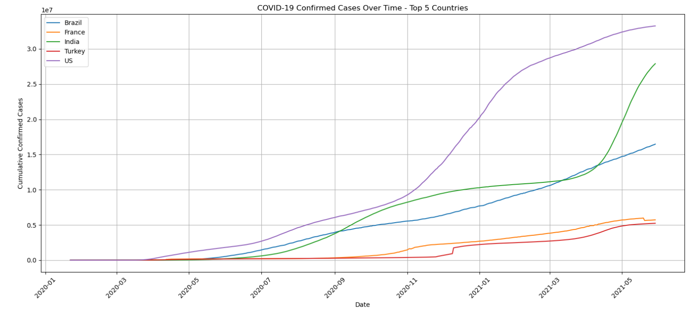
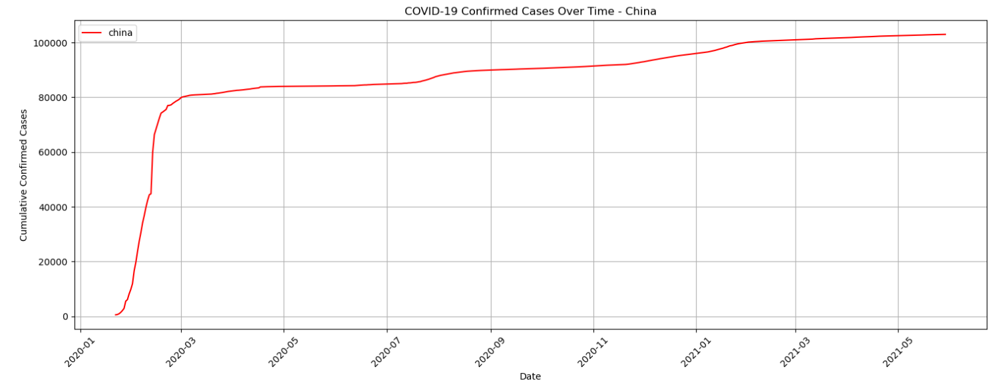
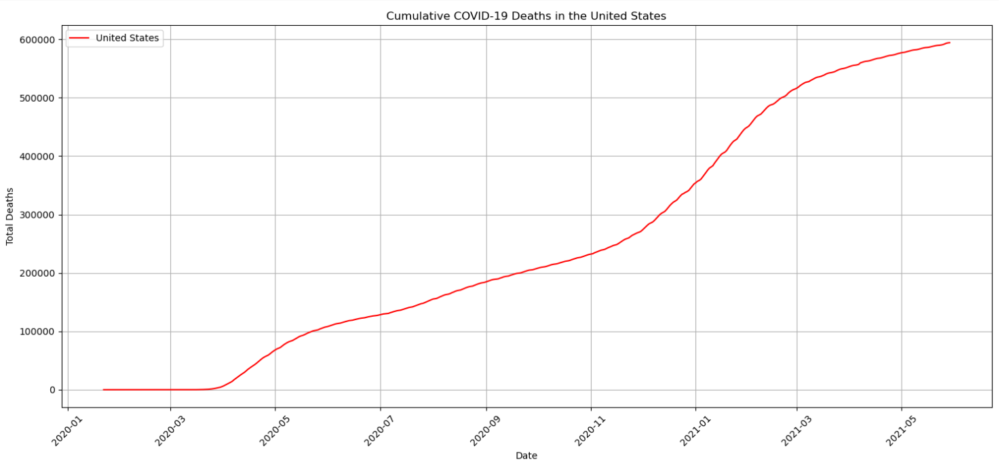
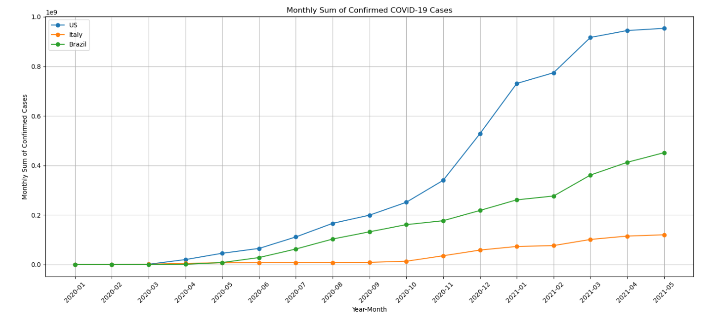

# COVID-19 Data Analysis

## Project Overview

This project explores the global impact of COVID-19 using confirmed cases, deaths, and recoveries data. The analysis uses Python and its data analysis libraries to clean, transform, merge, analyze, and visualize COVID-19 data.

The objective is to identify pandemic trends, compare country-level statistics, and derive meaningful insights through exploratory data analysis.

## Technologies Used

- Python
- Pandas
- NumPy
- Matplotlib
- Jupyter Notebook
- Microsoft Excel

## Dataset

The project uses an Excel dataset containing three worksheets:

- COVID-19 Confirmed Cases
- COVID-19 Deaths
- COVID-19 Recoveries

**Analysis period:** January 22, 2020 – May 29, 2021.

## Project Workflow

### 1. Data Loading and Exploration
- Imported datasets using Pandas.
- Explored dataset dimensions, columns, and data types.
- Examined country and date information.

### 2. Data Cleaning
- Identified missing values.
- Handled missing daily values using forward filling.
- Replaced missing Province/State values with "All Provinces".
- Preserved missing geographical coordinates where appropriate.

### 3. Data Analysis and Visualization
- Analyzed COVID-19 trends across countries.
- Compared confirmed cases over time.
- Visualized China's confirmed cases.
- Identified peak daily new cases in Germany, France, and Italy.
- Compared recovery rates between Canada and Australia.
- Analyzed death rates across Canadian provinces and territories.

### 4. Data Transformation
- Converted the deaths dataset from wide format to long format using Pandas `melt()`.
- Converted date columns into datetime format.
- Calculated country-wise cumulative deaths.
- Identified countries with the highest average daily deaths.
- Visualized cumulative deaths in the United States.

### 5. Data Merging
- Transformed confirmed, deaths, and recovered datasets into long format.
- Aggregated records by country and date.
- Merged the three datasets using Country/Region and Date.
- Analyzed monthly sums for confirmed cases, deaths, and recoveries.

### 6. Combined Data Analysis
- Identified countries with the highest average death rates during 2020.
- Compared recoveries and deaths in South Africa.
- Analyzed monthly recovery ratios for the United States.

## Key Findings

- The United States recorded the highest cumulative deaths (594,306) as of May 29, 2021.
- France experienced the highest single-day surge among Germany, France, and Italy, with 117,900 reported new cases on April 11, 2021.
- Canada recorded a higher recovery rate (84.47%) than Australia (79.38%) as of December 31, 2020.
- Quebec had the highest death rate (3.01%) among Canadian provinces and territories.
- Yemen recorded the highest average daily death-rate percentage (24.95%) among the countries analyzed during 2020, followed by Sudan (10.37%) and Italy (9.72%).
- South Africa recorded 1,554,184 recoveries compared with 56,363 deaths as of May 29, 2021.
- The United States recorded its highest monthly recovery ratio (39.58%) in October 2020.

## Important Data Limitations

- The dataset covers January 22, 2020, to May 29, 2021.
- Some countries have missing or incomplete recovery records.
- US recovery values are zero from January 2021 onwards in the source dataset.
- Monthly sums calculated from cumulative daily figures represent sums of cumulative observations, not actual new monthly cases or deaths.
- Reported statistics may be affected by differences in testing and reporting practices.

## How to Run the Project

1. Clone or download this repository.
2. Install the required Python libraries.
3. Open Jupyter Notebook.
4. Open `COVID_19_Case_Study.ipynb`.
5. Ensure the Excel dataset is available in the expected `dataset/` directory.
6. Execute the notebook cells sequentially.

Install dependencies using:

```bash
pip install -r requirements.txt
```

## Project Structure

```text
COVID-19-Data-Analysis/
│
├── dataset/
│   └── covid_19_dataset.xlsx
│
├── images/
│   └── charts and visualizations
│
├── notebooks/COVID_19_Case_Study.ipynb
├── README.md
├── requirements.txt
└── .gitignore
```

## Project Visualizations

### 1. Top 5 Countries - Confirmed Cases
Comparison of cumulative confirmed COVID-19 cases across the top five countries.



### 2. China - Confirmed Cases Trend
Cumulative confirmed cases in China over the analysis period.



### 3. United States - Cumulative Deaths
Progression of cumulative COVID-19 deaths in the United States.



### 4. United States - Monthly Recovery Ratio
Monthly recovery ratio in the United States from March 2020 to May 2021.



## Conclusion

This project demonstrates practical data analysis skills using Python, Pandas, NumPy, and Matplotlib. It covers data cleaning, exploratory data analysis, data transformation, merging, statistical calculations, and data visualization to understand the global impact of COVID-19.
